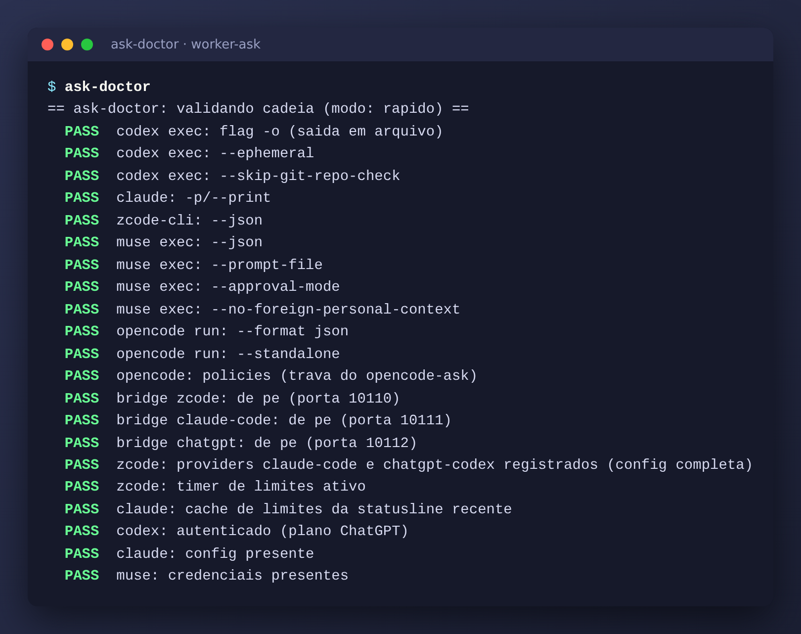

# worker-ask-router

[Português](README.md) · **English**

  

The `worker-ask-router` routes coding slices across the Codex, Claude, ZCode, Muse, and OpenCode executors from a single command. The installed command is still called `worker-ask`. When a provider hits its quota (exit 75) or the executable is missing, the next executor in the chain takes over with no manual intervention.



*`ask-doctor` checking the wrapper chain (Codex, Claude, ZCode, Muse, and OpenCode) before routing tasks.*

## Contents

- [Features](#features)
- [Quickstart](#quickstart)
- [Usage](#usage)
- [How it works](#how-it-works)
- [Advanced features](#advanced-features)
- [Limitations and responsible use](#limitations-and-responsible-use)
- [Documentation](#documentation)
- [Contributing](#contributing)
- [License](#license)

## Features

- Executor switching with no rework: automatic fallback triggers the next in the chain when a provider hits its quota (exit 75) or the executable is missing.
- Per-slice budget: `--task-id` records each run in `runs.jsonl` and caps each task at 4 runs.
- Optional worktree isolation: the worker edits a copy of the project and only the allowed files return to the real directory.
- Chain observability: terminal presentation, logging with `--log`, and per-run metrics via `scripts/runs_report.py`.
- Quota without probing: the router reads the reset deadline reported by the provider and skips executors in cooldown until it expires.
- Repeatable installation: `python3 scripts/install.py` validates sources and destinations, swaps links atomically, and attempts to restore the previous files on failure.

## Quickstart

Requirements:

- Linux with Python 3.10+.
- Node, required for the ZCode launcher.
- Each provider's CLIs installed and authenticated outside the repository.

```bash
python3 scripts/install.py
# To verify in a staging directory, without touching the current installation:
python3 scripts/install.py --home /caminho/de/staging
```

The installed `~/.local/bin/worker-ask` command points to `worker_router.py` at this root. The shortest path to the first result:

```bash
worker-ask --cwd /caminho/do/projeto --orchestrator codex --mode plan "tarefa"
worker-ask --cwd /caminho/do/projeto --orchestrator codex --mode write --allowed-file src/exemplo.py "tarefa"
```

## Usage

Command-line options (`worker-ask --help` shows the full text):

| Option | Function |
|---|---|
| `--cwd` | Project directory where the worker runs. |
| `--mode {plan,write}` | `plan` reads only; `write` edits (default). |
| `--providers` | Restricts the call to the listed providers, comma-separated. |
| `--spec` | File holding the task specification. |
| `prompt` | Free-text task, as a positional argument. |
| `--timeout` | Total deadline in seconds (default 1800). |
| `--step-timeout` | Per-attempt deadline in seconds (default 900). |
| `--orchestrator {codex,claude,zcode,muse,opencode}` | Who delegates; does not exclude executors from the same platform. |
| `--task-id` | Identifies the slice; records in `runs.jsonl` and enables the 4-run budget. |
| `--mark-redo ID` | Records a redo event for the task and exits. |
| `--allowed-file` | File the slice may create or edit; repeat per file (max 128). |
| `--no-muse` | Excludes Muse from this call. |
| `--allow-muse` | Obsolete, kept for compatibility (Muse is already the default). |
| `--retry-exhausted` | Manually re-evaluates executors blocked on unknown quota. |
| `--status` | Shows isolation slots and quota deadlines, then exits. |
| `--refresh-availability` | Refreshes the availability table and exits. |
| `--stats` | Prints the `runs.jsonl` JSON summary and exits. |
| `--log FILE` | Writes stdout, stderr, and the final `exit=N` line to the file, keeping output on the terminal. |
| `--isolation-gc` | Removes stale isolation slots and rejected copies, then exits. |

Exit codes: `0` ok, `1` error, `75` quota (the router moves to the next executor), `124` timeout. Automatic fallback happens only on exit 75 or a missing executable; exit 1 stops the chain to preserve possible partial changes. In write mode, changes to the allowed files after exit 75 block the fallback. The terminal presentation summarizes each attempt:

```text
◆ Workers · escrita · …/meu-projeto · 3 arquivos · spec-fatia5.md · limite 40min
  ↳ ZCode (glm-5.3-flash)
  ↷ ZCode: cota, tentando o próximo
  ↳ OpenCode (auto)
✓ OpenCode (auto) · 3m02s · validação pendente
  tentativas: ZCode cota (rc 75) → OpenCode ✓
```

## How it works

| Component | Function |
|---|---|
| `worker_router.py` | Executor selection, total timeout, cooldown, and allowed-file verification. |
| `bin/codex-ask`, `bin/claude-ask`, `bin/muse-ask`, `bin/opencode-ask`, `bin/bonsai-ask` | One wrapper per system. |
| `bin/ask-doctor`, `bin/ask-check` | Interface and update diagnostics; the doctor's full mode makes real calls. |
| `scripts/install.py` | Joint, repeatable installation, with code backups and rollback. |
| `adapters/bonsai/` | GameMode/GPU client and guards, with no key, model, or service provisioned. |
| `bin/ask_presentation.py` | Terminal presentation. |
| `adapters/zcode/` | ZCode engine, authentication persistence, launcher, and tests. |
| `bin/zcode-worker`, `bin/zcode-cli` | Local entry and process admission. |

## Advanced features

Full details in [docs/operacao.md](docs/operacao.md) (Portuguese only):

- Worktree isolation: per-attempt project copy, with only the allowed files handed back.
- State fallback: the chain moves on when a shell-less worker exits without changing anything.
- Presentation and logging: `ASK_PRESENTATION`, `ASK_STYLE`, `--log`, and off-TTY heartbeat variables.
- Run log: one JSON line per run in `runs.jsonl`, summarized by `scripts/runs_report.py`.
- Quota and reset date: per-executor cooldown from the provider-reported date.
- Availability table: off-call quota lookup, with flock-based slot reservation.
- Worker chain: executor order, Muse opt-out, and the paid ZCode step last.
- Validation and quality gate: test commands and the nine-block gate.

## Limitations and responsible use

- Each provider's CLIs and their accounts are external dependencies; the repository provisions no login, models, or services.
- Without isolation, the allowed-file list is state verification, not a sandbox: a worker with shell access can still write outside via an absolute path.
- Timeout (exit 124) is not quota: it opens the executor's circuit for 300 seconds and, in write mode, the current call stops to preserve possible partial changes.
- `runs.jsonl` stores only metrics (executor, duration, attempts, spec hash, changed files); never prompt, spec, stdout, or stderr. Credentials, sessions, databases, caches, and generated reports do not belong in Git.
- Each attempt runs the providers' CLIs under their accounts; the `ask-doctor` full mode makes real calls.

## Documentation

- [Router operation](docs/operacao.md) (Portuguese only): isolation, state fallback, presentation, logs, quota, availability, chain, and validation.
- [Worker contract](docs/WORKER-CONTRACT.md): task and output format for executors.
- [codex-local](docs/codex-local.md): historical experiment outside the router.

## Contributing

Contributions are welcome as small, focused proposals; see [How to contribute](CONTRIBUTING.md).

## License

Distributed under the [MIT license](LICENSE).
