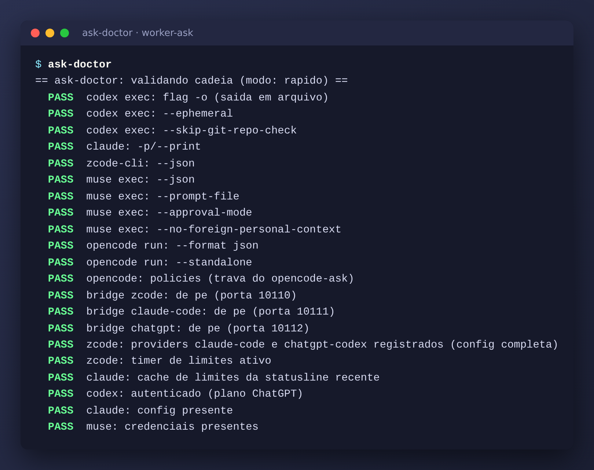

# worker-ask-router

**Português** · [English](README.en.md)

[](https://github.com/vitorcamillo/worker-ask-router/actions/workflows/ci.yml)   

O `worker-ask-router` roteia fatias de codificação entre os executores Codex, Claude, ZCode, Muse e OpenCode a partir de um único comando. O comando instalado continua se chamando `worker-ask`. Quando um provedor atinge a cota (saída 75) ou o executável está ausente, o próximo executor da cadeia assume sem intervenção manual.



*`ask-doctor` conferindo a cadeia de wrappers (Codex, Claude, ZCode, Muse e OpenCode) antes de rotear tarefas.*

## Sumário

- [Recursos](#recursos)
- [Início rápido](#início-rápido)
- [Uso](#uso)
- [Como funciona](#como-funciona)
- [Recursos avançados](#recursos-avançados)
- [Limitações e uso responsável](#limitações-e-uso-responsável)
- [Documentação](#documentação)
- [Contribuição](#contribuição)
- [Licença](#licença)

## Recursos

- Troca de executor sem retrabalho: o fallback automático aciona o próximo da cadeia quando um provedor atinge a cota (saída 75) ou o executável está ausente.
- Orçamento por fatia: `--task-id` registra cada execução em `runs.jsonl` e limita a 4 execuções por tarefa.
- Isolamento opcional por worktree: o worker edita uma cópia do projeto e só os arquivos autorizados voltam ao diretório real.
- Observabilidade da cadeia: apresentação no terminal, log com `--log` e métricas por execução com `scripts/runs_report.py`.
- Cota sem sondagem: o roteador lê o prazo de liberação informado pelo provedor e pula executores em cooldown até o vencimento.
- Instalação repetível: `python3 scripts/install.py` valida fontes e destinos, troca links atomicamente e tenta restaurar os arquivos anteriores em falha.

## Início rápido

Requisitos:

- Linux com Python 3.10+.
- Node, necessário para o launcher ZCode.
- CLIs de cada provedor instalados e autenticados fora do repositório.

```bash
python3 scripts/install.py
# Para verificar em um diretório de staging, sem alterar a instalação atual:
python3 scripts/install.py --home /caminho/de/staging
```

O comando instalado `~/.local/bin/worker-ask` aponta para `worker_router.py` desta raiz. O menor caminho até o primeiro resultado:

```bash
worker-ask --cwd /caminho/do/projeto --orchestrator codex --mode plan "tarefa"
worker-ask --cwd /caminho/do/projeto --orchestrator codex --mode write --allowed-file src/exemplo.py "tarefa"
```

## Uso

Opções de linha de comando (`worker-ask --help` mostra o texto completo):

| Opção | Função |
|---|---|
| `--cwd` | Diretório do projeto onde o worker roda. |
| `--mode {plan,write}` | `plan` só lê; `write` edita (padrão). |
| `--providers` | Restringe a chamada aos provedores listados, separados por vírgula. |
| `--spec` | Arquivo com a especificação da tarefa. |
| `prompt` | Tarefa em texto livre, como argumento posicional. |
| `--timeout` | Prazo total em segundos (padrão 1800). |
| `--step-timeout` | Prazo por tentativa em segundos (padrão 900). |
| `--orchestrator {codex,claude,zcode,muse,opencode}` | Quem delega; não exclui executores da mesma plataforma. |
| `--task-id` | Identifica a fatia; grava no `runs.jsonl` e habilita o orçamento de 4 execuções. |
| `--mark-redo ID` | Registra um evento redo para a tarefa e sai. |
| `--allowed-file` | Arquivo que a fatia pode criar ou editar; repetir por arquivo (máximo 128). |
| `--no-muse` | Exclui o Muse desta chamada. |
| `--allow-muse` | Obsoleto, mantido por compatibilidade (Muse já é padrão). |
| `--retry-exhausted` | Reavalia manualmente executores bloqueados por cota desconhecida. |
| `--status` | Mostra vagas de isolamento e prazos de cota, e sai. |
| `--refresh-availability` | Atualiza a tabela de disponibilidade e sai. |
| `--stats` | Imprime o resumo JSON do `runs.jsonl` e sai. |
| `--log ARQ` | Grava stdout, stderr e a linha final `exit=N` no arquivo, mantendo a saída no terminal. |
| `--isolation-gc` | Remove slots de isolamento e cópias rejeitadas antigas, e sai. |

Códigos de saída: `0` ok, `1` erro, `75` cota (o roteador passa ao próximo executor), `124` timeout. O fallback automático ocorre somente em saída 75 ou executável ausente; saída 1 encerra a cadeia para preservar possíveis alterações parciais. Em escrita, mudanças nos arquivos autorizados após saída 75 bloqueiam o fallback. A apresentação no terminal resume cada tentativa:

```text
◆ Workers · escrita · …/meu-projeto · 3 arquivos · spec-fatia5.md · limite 40min
  ↳ ZCode (glm-5.3-flash)
  ↷ ZCode: cota, tentando o próximo
  ↳ OpenCode (auto)
✓ OpenCode (auto) · 3m02s · validação pendente
  tentativas: ZCode cota (rc 75) → OpenCode ✓
```

## Como funciona

| Componente | Função |
|---|---|
| `worker_router.py` | Seleção de executores, timeout total, cooldown e verificação dos arquivos autorizados. |
| `bin/codex-ask`, `bin/claude-ask`, `bin/muse-ask`, `bin/opencode-ask`, `bin/bonsai-ask` | Wrappers de cada sistema. |
| `bin/ask-doctor`, `bin/ask-check` | Diagnóstico de interfaces e atualizações; o modo completo do doctor faz chamadas reais. |
| `scripts/install.py` | Instalação conjunta e repetível, com backups de código e rollback. |
| `adapters/bonsai/` | Cliente e guardas GameMode/GPU, sem chave, modelo ou serviço provisionado. |
| `bin/ask_presentation.py` | Apresentação do terminal. |
| `adapters/zcode/` | Engine, persistência de autenticação, launcher e testes do ZCode. |
| `bin/zcode-worker`, `bin/zcode-cli` | Entrada local e admissão de processos. |

## Recursos avançados

Detalhes completos em [docs/operacao.md](docs/operacao.md):

- Isolamento por worktree: cópia do projeto por tentativa, com devolução só dos arquivos autorizados.
- Fallback por estado: cadeia segue em frente quando o worker sem shell sai sem alterar nada.
- Apresentação e log: variáveis `ASK_PRESENTATION`, `ASK_STYLE`, `--log` e batimento fora de TTY.
- Log de execuções: uma linha JSON por execução em `runs.jsonl`, resumida por `scripts/runs_report.py`.
- Cota e data de liberação: cooldown por executor a partir da data informada pelo provedor.
- Tabela de disponibilidade: consulta de cota fora da chamada, com reserva de vaga por flock.
- Cadeia de workers: ordem dos executores, opt-out do Muse e degrau pago do ZCode por último.
- Validação e quality gate: comandos de teste e o portão de nove blocos.

## Limitações e uso responsável

- Os CLIs de cada provedor e suas contas são dependências externas; o repositório não provisiona login, modelos nem serviços.
- Sem isolamento, a lista de arquivos autorizados é verificação de estado, não sandbox: um worker com shell ainda consegue escrever fora por caminho absoluto.
- Timeout (saída 124) não é cota: abre o circuito do executor por 300 segundos e, em escrita, a chamada atual para para preservar possíveis alterações parciais.
- O `runs.jsonl` guarda só métricas (executor, duração, tentativas, hash da spec, arquivos alterados); nunca prompt, spec, stdout ou stderr. Credenciais, sessões, bancos, caches e relatórios gerados não entram no Git.
- Cada tentativa executa os CLIs dos provedores com suas contas; o modo completo do `ask-doctor` faz chamadas reais.

## Documentação

- [Operação do roteador](docs/operacao.md): isolamento, fallback por estado, apresentação, logs, cota, disponibilidade, cadeia e validação.
- [Contrato de worker](docs/WORKER-CONTRACT.md): formato de tarefa e saída para executores.
- [codex-local](docs/codex-local.md): experimento histórico fora do roteador.

## Contribuição

Contribuições são bem-vindas em propostas pequenas e focadas; veja [Como contribuir](CONTRIBUTING.md).

## Licença

Distribuído sob a [licença MIT](LICENSE).
